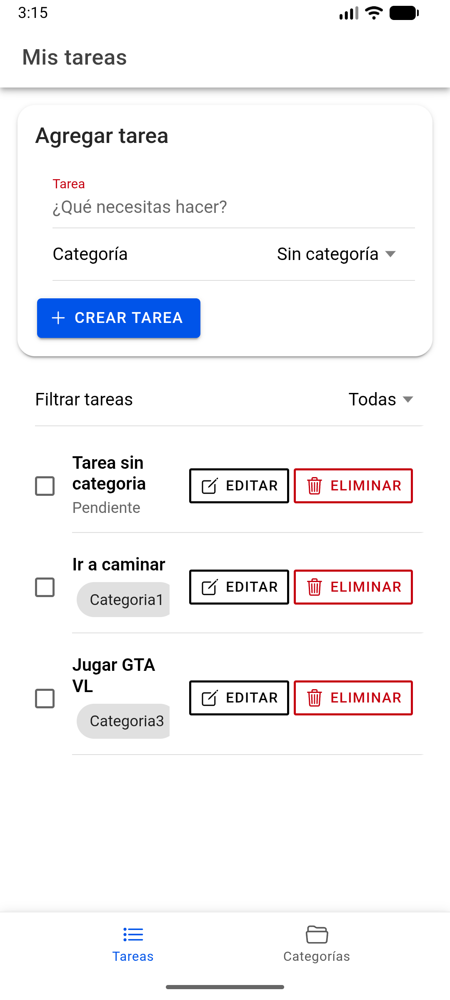
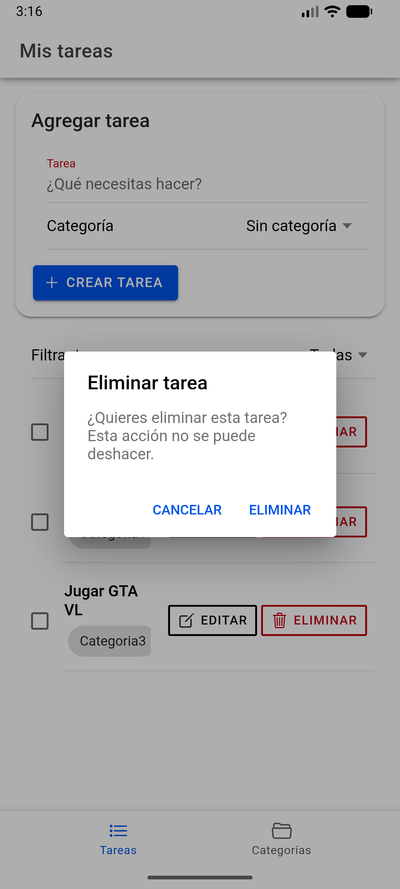
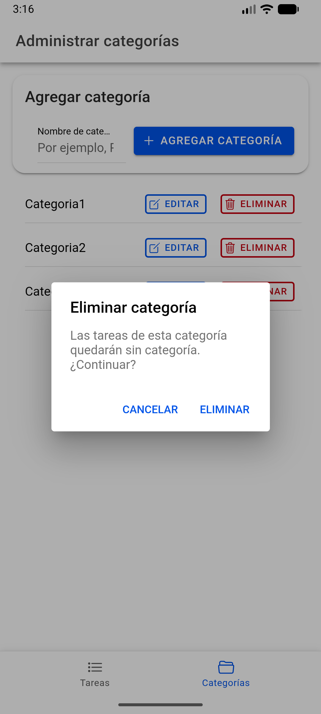

# Todo List

Aplicación de lista de tareas creada con Angular e Ionic y preparada para ejecutarse en la web y en Android mediante Capacitor.

## Funcionalidades

- Crear, editar, completar y eliminar tareas.
- Crear y administrar categorías, y asignarlas a las tareas.
- Guardar tareas y categorías localmente en el dispositivo.
- Mostrar un filtro de categorías controlado por Firebase Remote Config mediante el parámetro `category_filter_enabled`.

La app no sincroniza tareas con Firebase ni utiliza Firestore. Si Remote Config no está configurado o no hay conexión, la app sigue funcionando y el filtro permanece desactivado.

## Capturas y demostración

### Tareas y categorías



### Eliminar una tarea



### Eliminar una categoría



### Video de demostración
[Abrir video](https://1drv.ms/v/c/8ab5e56e8cb22d9f/IQCDjcXBVBtwTJgvYKADRRUTAasgpptYW_5T1yVxqXf04bw?e=ZxzMLi)


## Requisitos

- Node.js compatible con Angular 22 (por ejemplo, Node.js 22.22.3 o posterior dentro de la rama 22).
- npm, que se instala junto con Node.js.
- Para Android: Android Studio, Android SDK y JDK 17 o posterior. Android Gradle Plugin 8 requiere JDK 17.

## Instalación

Desde la raíz del proyecto, instala las dependencias:

```bash
npm install
```

## Ejecutar en la web

Inicia el servidor de desarrollo:

```bash
npm start
```

Abre la URL que muestra Angular CLI, normalmente `http://localhost:4200`.

## Ejecutar en Android

La plataforma Android ya está incluida en `android/`. Para compilar el frontend, sincronizar los cambios con Capacitor y abrir Android Studio:

```bash
npm run build
npx cap sync android
npx cap open android
```

## Configuración de Firebase

La app usa Firebase Remote Config para el parámetro booleano `category_filter_enabled`. En Firebase Console, configura y publica ese parámetro. Para Android, registra una app con el ID de paquete `io.ionic.starter` y guarda su archivo `google-services.json` en `android/app/`. El archivo está excluido de Git.

Para la versión web, completa los valores de Firebase en:

- `src/environments/environment.ts`
- `src/environments/environment.prod.ts`

## Comandos disponibles

| Comando         | Descripción                                       |
| --------------- | ------------------------------------------------- |
| `npm start`     | Inicia el servidor web de desarrollo.             |
| `npm run build` | Compila la aplicación web.                        |
| `npm run watch` | Compila continuamente en modo desarrollo.         |
| `npm run lint`  | Ejecuta ESLint.                                   |
| `npm test`      | Ejecuta las pruebas configuradas con Angular CLI. |

## Estructura principal

- `src/app/tasks/`: entidades, lógica y pantallas de tareas y categorías.
- `src/app/shared/`: componentes y servicios compartidos, incluido Remote Config.
- `src/environments/`: configuración de entornos web.
- `android/`: proyecto nativo Android de Capacitor.
